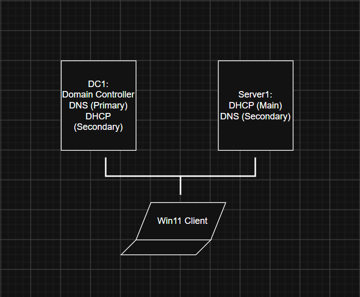

# Title
- WinLabServerRoles

# Author
- Brent Haven Dancel

# Description
- Purpose: Install Server Roles on Window Server VMs to finalize 
    1) Install on DC1 VM the Domain Controller Role and DNS Server Role
    2) Install on Server1 DHCP and DNS Server Role

  
   
  <em>Figure 1. Virtual Windows Lab</em>

DC1 (Domain Controller w/ DNS)  
IPv4 Address: 192.168.0.10  
Subnet: 255.255.255.0  
Default Gateway: 192.168.0.1  
Preferred DNS Server: 192.168.0.10  
Alternate DNS Server: 192.168.0.20  

Server1 (DHCP, DNS, Other services)  
IPv4 Address: 192.168.0.20  
Subnet: 255.255.255.0  
Default Gateway: 192.168.0.1  
Preferred DNS Server: 192.168.0.20  
Alternate DNS Server: 192.168.0.10  

Win11Client (Static IP)  
IPv4 Address: 192.168.0.2  
Subnet: 255.255.255.0  
Default Gateway: 192.168.0.1  
Preferred DNS Server: 192.168.0.10  
Alternate DNS Server: 192.168.0.20  

# Tools/Technologies Used
- Oracle VirtualBox
- Windows Server VM (DC1)
- Windows Server VM (Server1)
- Windows 11 Home Edition VM (Client)
- Visual Studio Code w/ Prettier and PowerShell extensions

# How to Use/Navigate
- Screenshots will be included within the documentation this time
- PowerShell Scripts will also be included to automate process

1) The WinLabServerRoles-documentation file will include my steps on installing the server roles
2) The WinLabServerRoles-troubleshooting file will include any problems I encountered

# Additional Notes
- Refer to VirtualWinLabSetup Repository for Initial Installation of lab environment