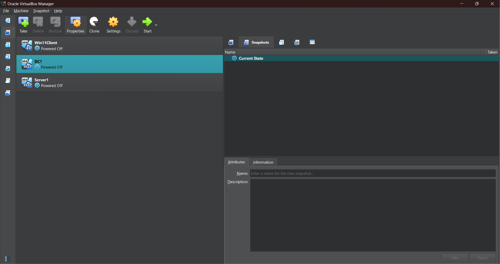
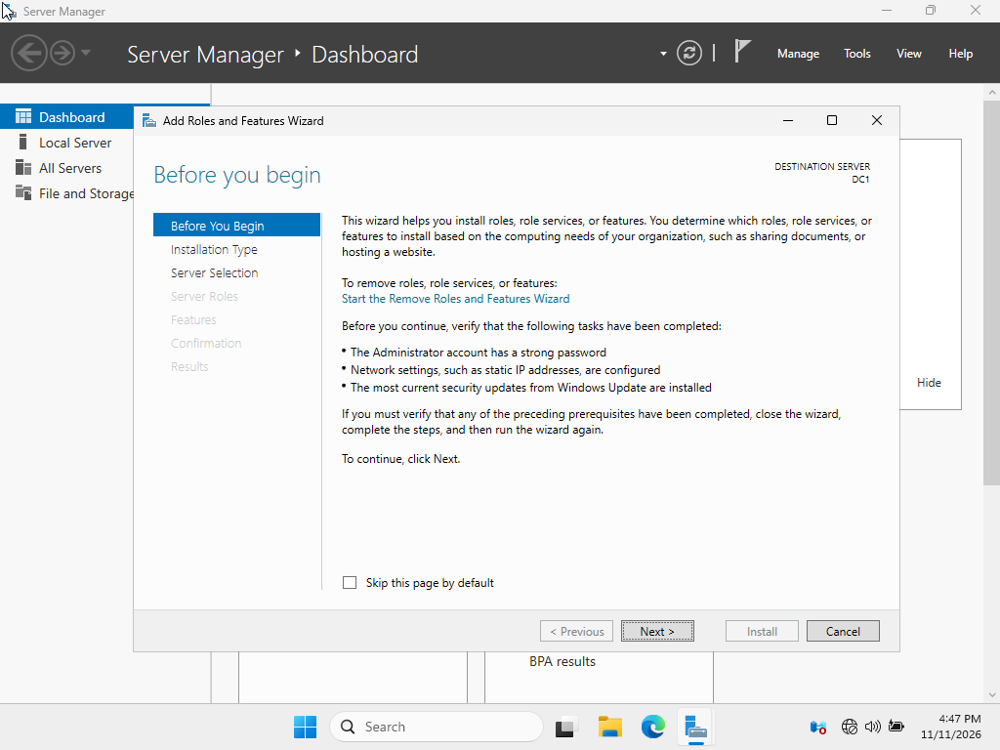
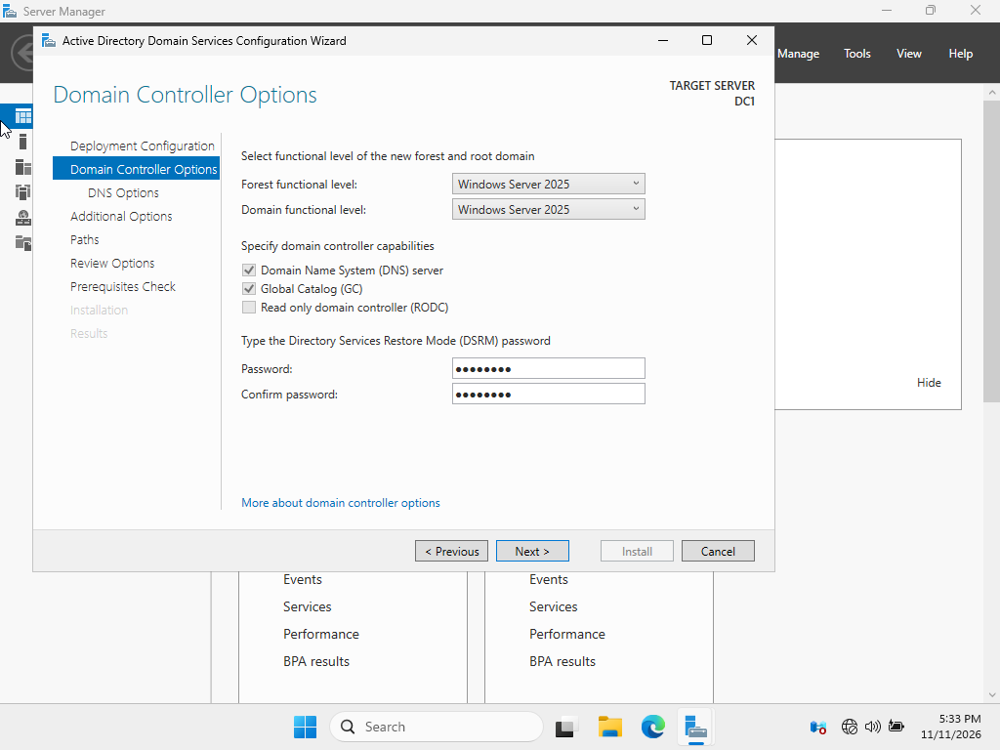
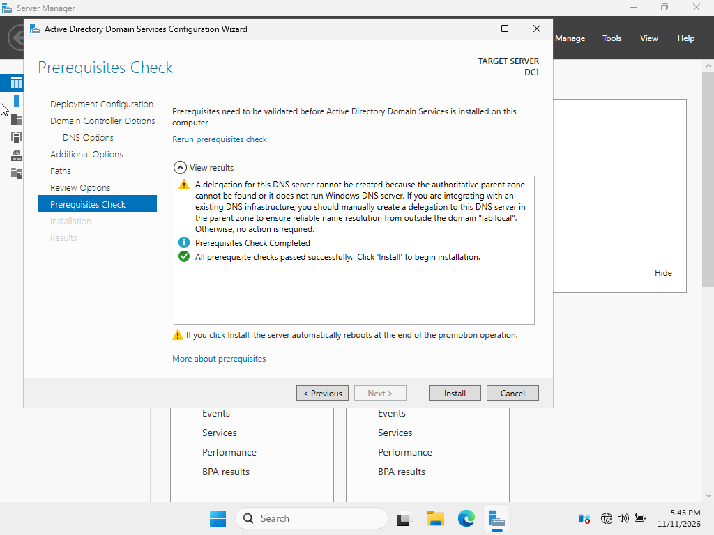

# Oracle VirtualBox Snapshots
Before installing anything, IT IS IMPORTANT TO TAKE SNAPSHOTS OF YOUR VMS IN CASE OF VM FAILURES  

<table>
  <tr>
    <td align="center">
      
       
      <em>SnapShot Feature Located Top Left</em>
        
    </td>
  </tr>
  <tr>
    <td align="center">
      
       
      <em>SnapShot Interface</em>
        
    </td>
  </tr>
  <tr>
    <td align="center">
      
       
      <em>SnapShot Success</em>
        
    </td>
  </tr>
</table>

Do this with Server1 VM
!!! Before configuring a VM, it is best practice to take a snapshot !!!

# Installing Server Roles on DC1  
1) Start Up DC1 VM  
2) Navigate to Server Manager Application  
3) Click on "Add Roles and features"

  
   
  <em>Add Roles and features</em>

4) At the "Installation Type" window, ensure that Role-Based or feature-based installation is selected
5) At the "Server Role" window, check the Active Directory Domain Services and DNS Server boxes

    - A window will appear asking to install additional features for both Active Directory Services and DNS Server boxes. INSTALL THE ADDITIONAL FEATURES

  
   
  <em>Additional Features</em>

6) At the "Confirmation" window, review the roles being installed and install them
7) Afterwards, a warning should appear top right, stating "Promote this server to a domain controller"

  
   
  <em>Post Install</em>

8) The Active Directory Domain Services Configuration Wizard should appear. Select the "Add a new forest" button and name your root domain as desired
    - We are adding a new forest because this is a completely new IT environment and establishes the first domain

  
   
  <em>Active Directory Domain Services Configuration Wizard</em>

9) At the "Domain Controller Options" window, ensure that the first two boxes are selected and input your desired password for DSRM
    - DNS is selected because it provides name resolution for AD
    - GC is selected because it provides searchable information
    - RODC is NOT selected because it provides a READ-ONLY copy of your server      

  
   
  <em>Domain Controller Options</em>

10) At the "Prerequisites Check" window, view the results and install when ready
    - A warning about the authoritative parent zone will appear. THIS IS OKAY SINCE THIS IS THE FIRST DOMAIN CONTROLLER AND DNS SERVER
    - The DC1 will restart

  
   
  <em>Prerequisites Check</em>

# Installing Server Roles on Server1  

# Test Connectivity between VMs  