# Oracle VirtualBox Snapshots
Before installing anything, IT IS IMPORTANT TO TAKE SNAPSHOTS OF YOUR VMS IN CASE OF VM FAILURES  

<table>
  <tr>
    <td align="center">
      
       
      <em>SnapShot Feature Located Top Left</em>
        
    </td>
  </tr>
  <tr>
    <td align="center">
      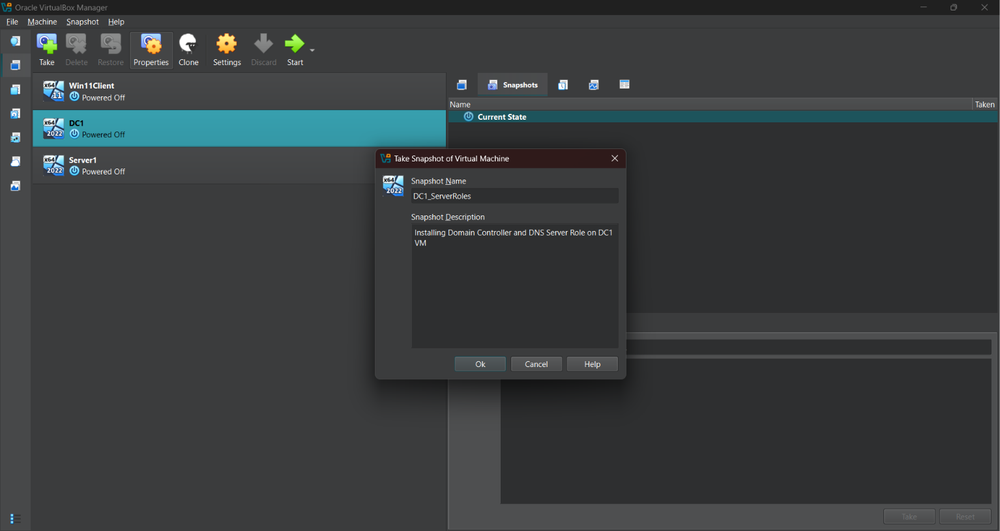
       
      <em>SnapShot Interface</em>
        
    </td>
  </tr>
  <tr>
    <td align="center">
      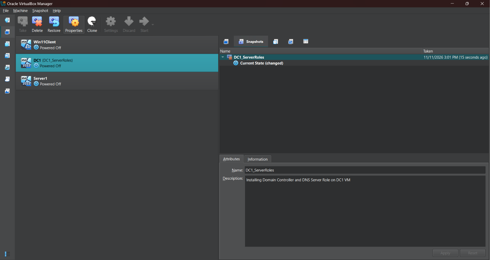
       
      <em>SnapShot Success</em>
        
    </td>
  </tr>
</table>

Do this with Server1 VM
!!! Before configuring a VM, it is best practice to take a snapshot !!!

# Installing Server Roles on DC1  
1) Start Up DC1 VM  
2) Navigate to Server Manager Application  
3) Click on "Add Roles and features"

  
   
  <em>Add Roles and features</em>

4) At the "Installation Type" window, ensure that Role-Based or feature-based installation is selected
5) At the "Server Role" window, check the Active Directory Domain Services and DNS Server boxes

    - A window will appear asking to install additional features for both Active Directory Services and DNS Server boxes. INSTALL THE ADDITIONAL FEATURES

  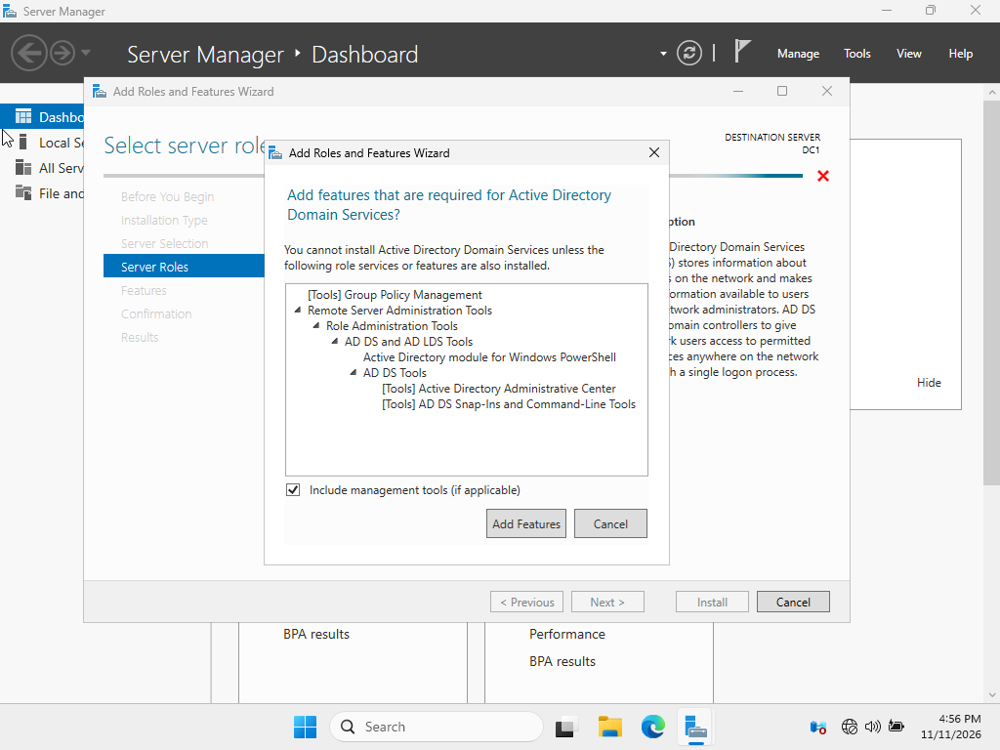
   
  <em>Additional Features</em>

6) At the "Confirmation" window, review the roles being installed and install them
7) Afterwards, a warning should appear top right, stating "Promote this server to a domain controller"

  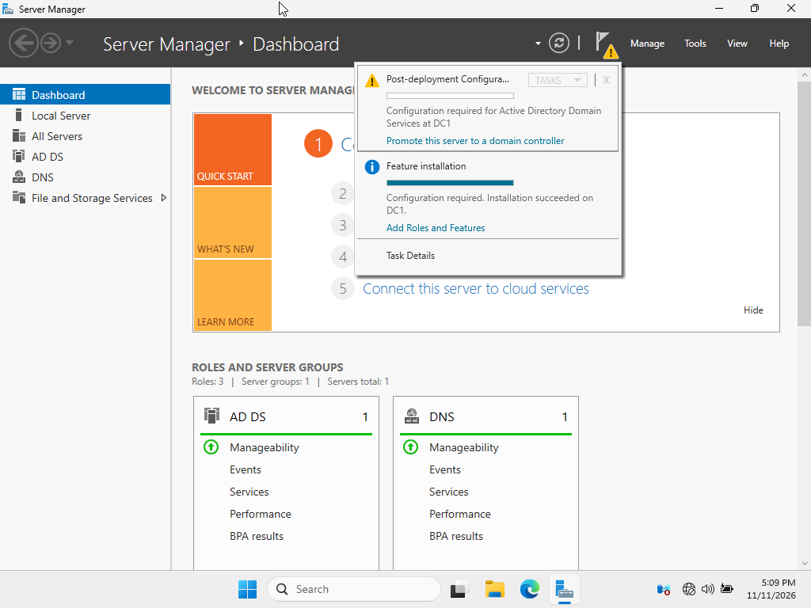
   
  <em>Post Install</em>

8) The Active Directory Domain Services Configuration Wizard should appear. Select the "Add a new forest" button and name your root domain as desired
    - We are adding a new forest because this is a completely new IT environment and establishes the first domain

  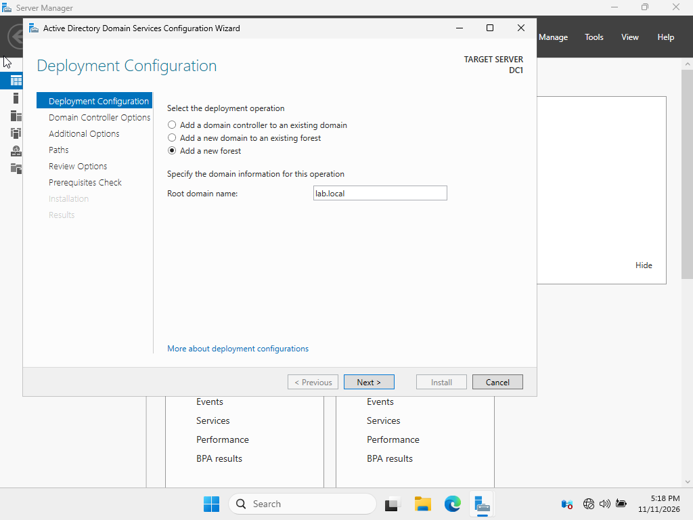
   
  <em>Active Directory Domain Services Configuration Wizard</em>

9) At the "Domain Controller Options" window, ensure that the first two boxes are selected and input your desired password for DSRM
    - DNS is selected because it provides name resolution for AD
    - GC is selected because it provides searchable information
    - RODC is NOT selected because it provides a READ-ONLY copy of your server      

  
   
  <em>Domain Controller Options</em>

10) At the "Prerequisites Check" window, view the results and install when ready
    - A warning about the authoritative parent zone will appear. THIS IS OKAY SINCE THIS IS THE FIRST DOMAIN CONTROLLER AND DNS SERVER
    - The DC1 will restart

  
   
  <em>Prerequisites Check</em>

# Installing Server Roles on Server1  
1) Start Up Server1 VM  
2) Navigate to Server Manager Application  
3) Click on "Add Roles and features"
4) At the "Installation Type" window, ensure that Role-Based or feature-based installation is selected
5) At the "Server Role" window, check the DHCP Server Box

    - A window will appear asking to install additional features for DHCP. INSTALL THE ADDITIONAL FEATURES

  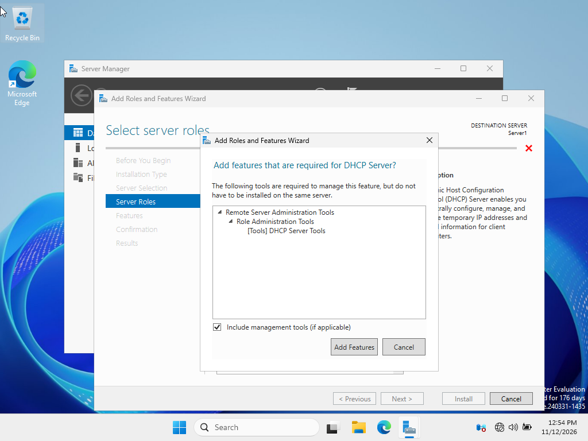
   
  <em>Additional Features (DHCP)</em>

6) At the "Confirmation" window, review the role being installed and install it
7) Afterwards, click on "Complete DHCP Configuration"
  - If you accidentally close it, a warning symbol should appear top right asking to complete DHCP Post Install

<table>
  <tr>
    <td align="center">
      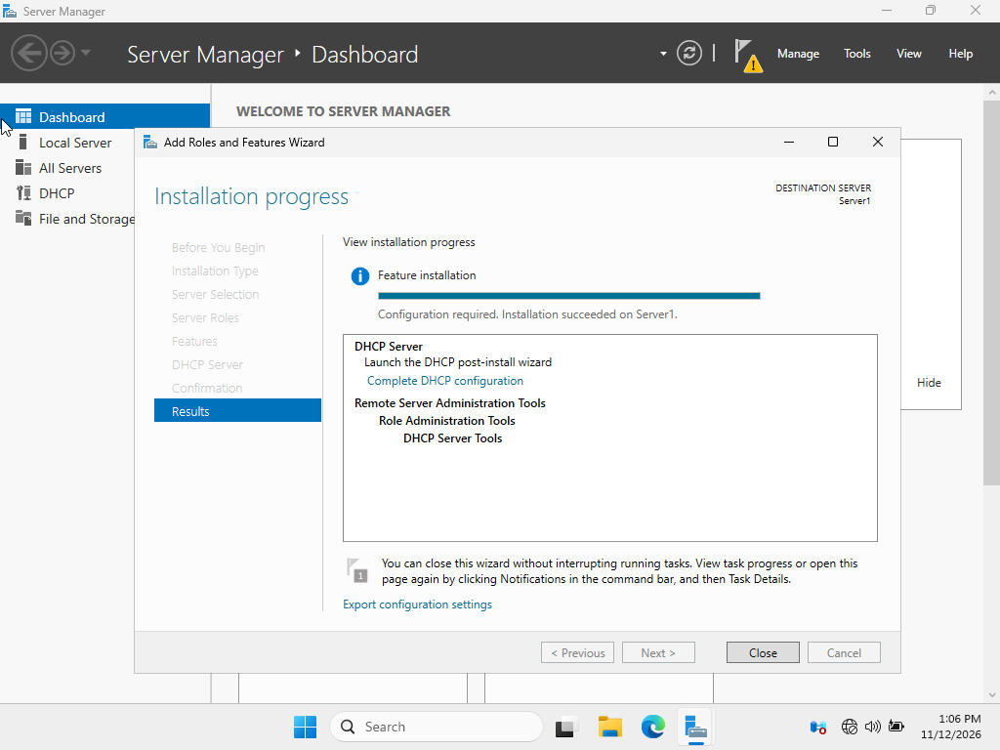
       
      <em>Post Install (DHCP) from Wizard</em>
    </td>
    <td align="center">
      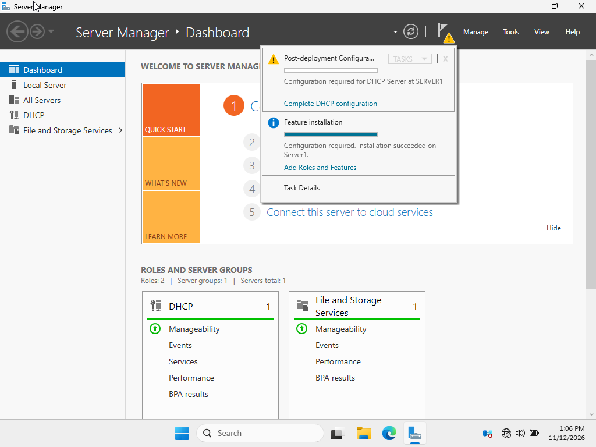
       
      <em>Post Install (DHCP) from menu</em>
    </td>
  </tr>
</table>

8) At the "DHCP Post-Install configuration wizard" window, click Commit

  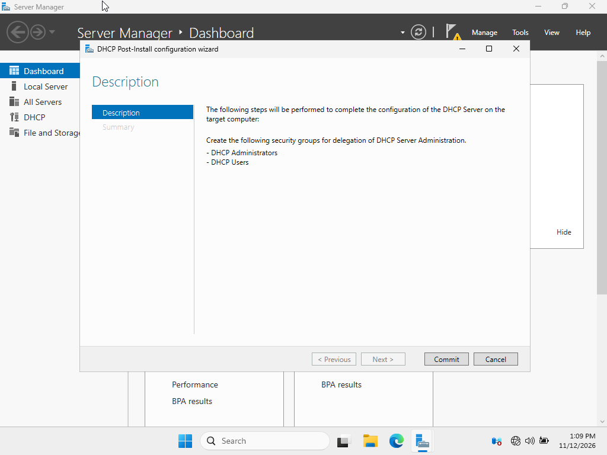
   
  <em>DHCP Post-Install Wizard</em>

# Domain-Join Server 1 to DC1
1) On the Server 1 VM, type into the Windows Search Bar "View advanced system settings"

  
   
  <em>This window should appear</em>

2) Click on the "Computer Name" tab

  
   
  <em>This menu should appear</em>

3) Click on "Change" button

4) In the "Computer Name/Domain Changes" window, under the "Member of" section, select the "Domain" radio button and input the domain name

  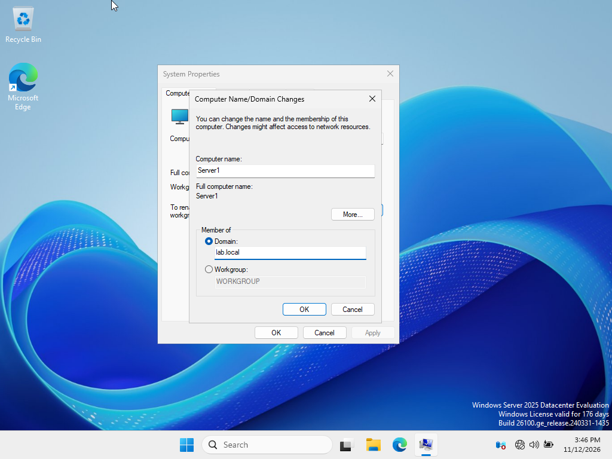
   
  <em>Domain-Joined Server 1</em>

5) "Windows Security" window appears, input the DOMAIN ADMINISTRATIVE credentials
  - Domain Administrative credentials varies from organization to organization

<table>
  <tr>
    <td align="center">
      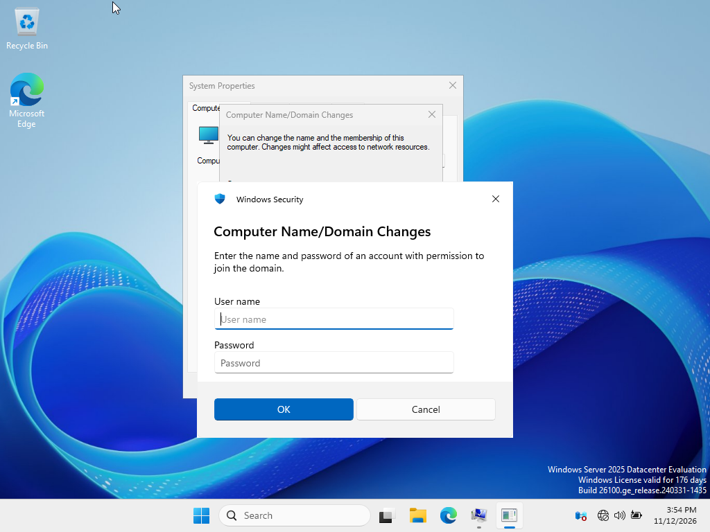
       
      <em>Domain Admin Credentials</em>
    </td>
    <td align="center">
      
       
      <em>Confirmed Credentials</em>
    </td>
  </tr>
</table>

6) Restart Server 1 VM

# Test and Verify Winlab Setup
Start Up DC1
Within Server Manager, click on "Tools" top right
Click on Active Directory Users and Computers
Click on Computers and look for Server1

  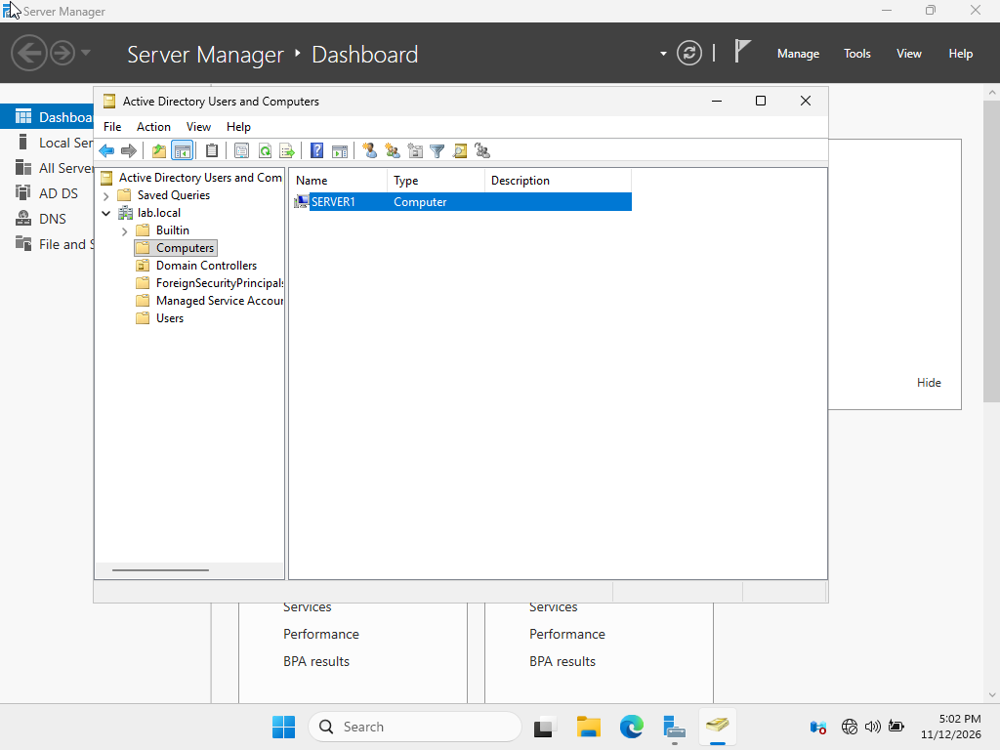
   
  <em>Server1 populates within DC1</em>

Start up Server1
Go back the advanced settings
Review the new computer name settings

  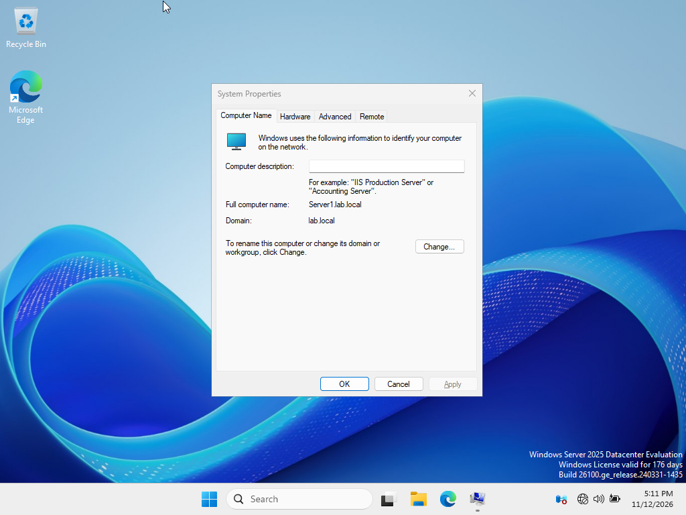
   
  <em>Server 1 Computer Name Change</em>

Conduct ping tests to ensure connectivity

  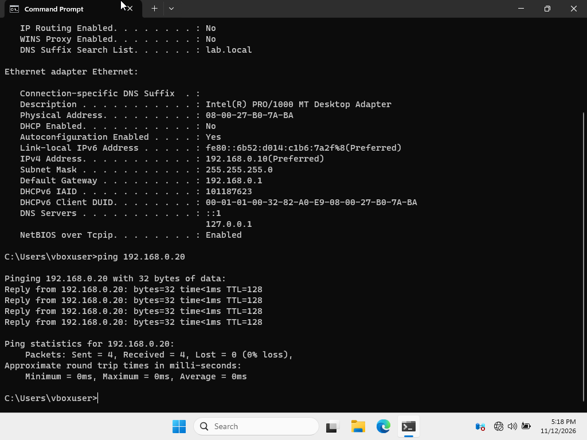
   
  <em>DC1 Ping Tests</em>

