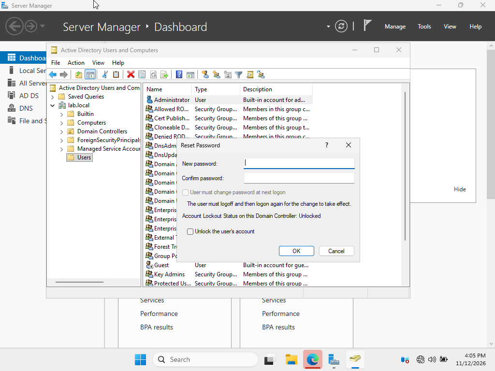
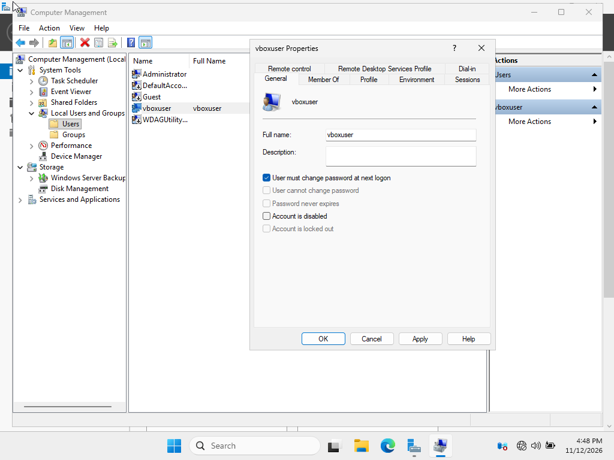

# Reset Administrative Password
When I tried to domain-join Server 1 to DC1, I forgot the password. I logged into DC1 with regular credentials. Then I clicked on "Tools" located top right. After, I clicked on "Active Directory Users and Computers." I navigates to "Users" to look for the Administrator account. I right-clicked on it to reset the password

  
   
  <em>Resetting the Domain Administrative Account password</em>

# Reset the local admin account password
After the restart of Server1 VM being domain-joined to DC1, I forgot the password. So what I did was I rolled back to a Snapshot (useful, amirite?). After successful automatic login, I searched for "Computer Management" in the Windows Search Bar. Then, I clicked on Local Users and Groups -> Users -> vboxuser(whatever you named the local account). I checked the "User must change password at next logon" and signed out.

  
   
  <em>Resetting the Local Account password</em>

